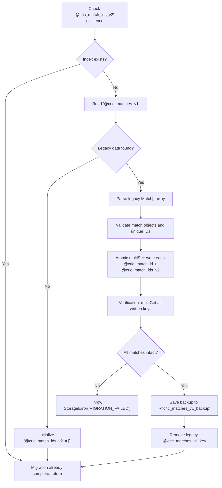

# Data Migration & Storage Architecture

This document outlines the persistence model, match-scoped storage design, command write serialization, and automatic migration algorithm implemented in **Cric**.

---

## 1. Background & Architectural Drivers

### Legacy Limitations (`@cric_matches_v1`)
In previous versions, all matches were stored in a monolithic array serialized under a single AsyncStorage key:
- **Write Amplification**: Every single delivery required re-serializing and writing the entire match history of the application.
- **Race Conditions**: Rapid concurrent delivery saves or parallel state updates could interleave, overwriting each other and dropping scored balls.
- **Data Loss Risk**: A crash or interrupted write during serialization of the monolithic array risked corrupting the entire database.

### Modern Partitioned Architecture (`@cric_match_<id>` + `@cric_match_ids_v2`)
The remediated storage engine partitions storage into isolated, match-scoped keys with an atomic registry index:
1. **Match-Scoped Keys**: `@cric_match_<matchId>` stores only the state of that individual match.
2. **Master Registry Index**: `@cric_match_ids_v2` stores the string array of all registered match IDs (`string[]`).
3. **In-Memory Write Serialization Queue**: Sequential promise chaining per `matchId` (`matchWriteQueues.get(matchId)`) guarantees strict FIFO write order.
4. **Structured Errors**: Failures throw typed `StorageError` instances with deterministic error codes (`WRITE_FAILED`, `READ_FAILED`, `PAYLOAD_CORRUPT`, `MIGRATION_FAILED`).

---

## 2. Storage Key Hierarchy

| Storage Key | Type | Description |
| :--- | :--- | :--- |
| `@cric_match_ids_v2` | `string[]` | Registry of all persisted match IDs. |
| `@cric_match_<id>` | `Match` | Full JSON state of an individual match. |
| `@cric_matches_v1_backup` | `Match[]` | Preserved backup of legacy monolithic match store. |
| `@cric_teams_v1` | `Team[]` | Registered teams and club squad rosters. |
| `@cric_user_profile_v1`| `UserProfile` | Active user account (defaults to Guest Scorer). |
| `@cric_join_requests_v1`| `JoinRequest[]` | Team squad join requests and approval statuses. |
| `@cric_tournaments_v1` | `Tournament[]` | Tournaments, fixtures, and standings. |

---

## 3. Migration Process (`migrateLegacyMatchesIfNeeded`)

When the application boots or any match operation is invoked, `StorageService.migrateLegacyMatchesIfNeeded()` runs automatically:



### Steps in Detail:
1. **Idempotency Gate**: Checks whether `@cric_match_ids_v2` is present. If it is, the function returns immediately without I/O overhead.
2. **Detection**: Reads the legacy key `@cric_matches_v1`. If absent, an empty array is written to `@cric_match_ids_v2` and initialization completes.
3. **Partitioning**: Iterates through each legacy match, constructing key-value pairs `['@cric_match_' + m.id, JSON.stringify(m)]`.
4. **Atomic Multi-Set**: Commits all partitioned match records and the master ID index in a single `AsyncStorage.multiSet` call.
5. **Round-Trip Verification**: Calls `AsyncStorage.multiGet` to read back all newly written keys and confirms that every match ID was successfully written and can be parsed.
6. **Safe Backup & Cleanup**: Writes the original JSON string to `@cric_matches_v1_backup` and deletes `@cric_matches_v1`.

---

## 4. Rollback and Disaster Recovery

In the event of an unrecoverable failure or corrupted storage:
1. The legacy payload is safely preserved under `@cric_matches_v1_backup`.
2. A manual or programmatic rollback can execute:
   ```ts
   const backup = await AsyncStorage.getItem('@cric_matches_v1_backup');
   if (backup) {
     await AsyncStorage.setItem('@cric_matches_v1', backup);
     await AsyncStorage.removeItem('@cric_match_ids_v2');
   }
   ```
3. `StorageError` ensures that failures are never silently swallowed; the UI receives explicit feedback rather than presenting a false "Saved" indicator.

---

## 5. Automated Verification

The migration logic and error handling are verified by automated tests in `tests/storage_resilience.test.ts`:
- `STORE-001: Structured persistence errors on failure`: Verifies error propagation on storage failure.
- `STORE-002: Match-scoped storage layout and legacy migration`: Verifies round-trip migration, backup preservation, and removal of the legacy key.
- `STORE-002: Command serialization prevents write interleaving`: Verifies that concurrent calls to `saveMatch` are executed in strict serial order.
